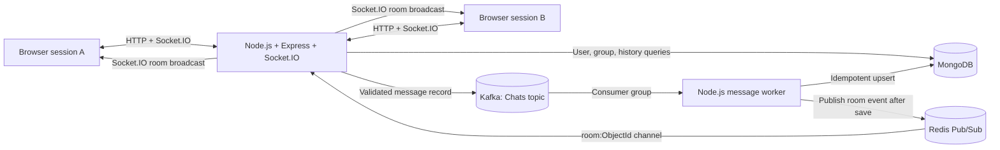

# Local architecture

## Message sequence

1. `index.js` starts Express and Socket.IO after MongoDB, Redis and the Kafka producer are available.
2. Authenticated socket handlers verify group existence/participant access and validate the message before `produceMessage()` writes a Kafka record keyed by UUID message ID.
3. `worker.js` consumes `Chats`. `kafka/messagePipeline.js` validates the record, performs a MongoDB upsert keyed by `messageId`, then publishes the saved message to `room:<roomid>` in Redis.
4. Each web process subscribed to that room broadcasts to its local Socket.IO room and returns persistence status to the originating socket.

## Deployment boundary

The local Compose stack runs one web process and one worker. Room membership and presence remain process-local; horizontal web replicas need a Socket.IO Redis adapter and shared presence design. Deployment notes remain in `DEPLOYMENT.md` and `PRE_DEPLOYMENT_ACCEPTANCE.md`; this diagram does not claim multi-instance readiness.
